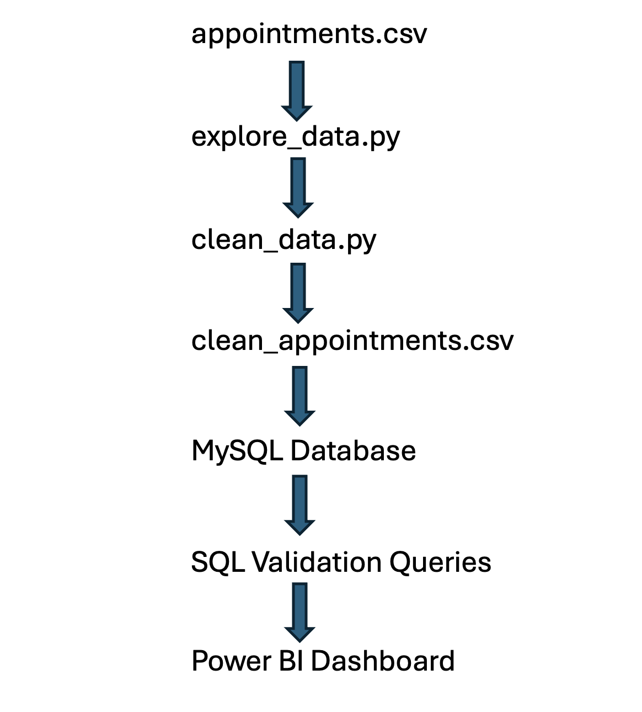
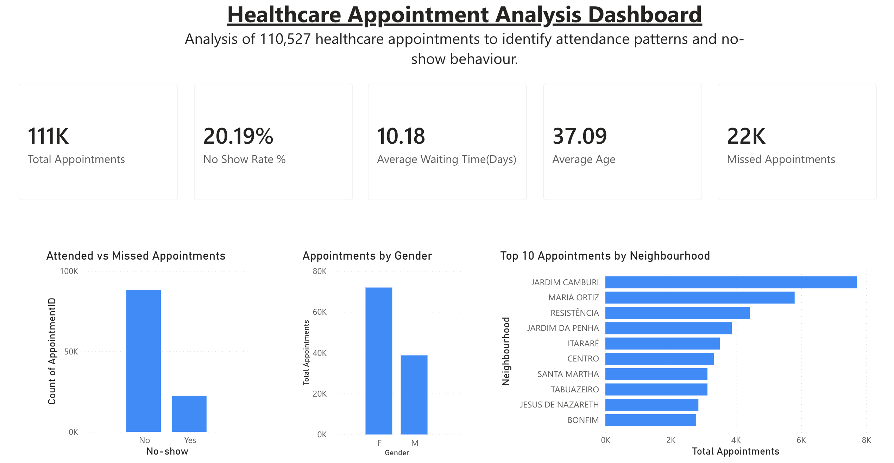

# Healthcare Appointment Analysis Pipeline #

## Project Overview ##

This project demonstrates an end-to-end healthcare data engineering and analytics workflow using Python, MySQL, DBeaver, and Power BI.

The aim of the project was to analyse healthcare appointment data, identify attendance patterns, and investigate appointment no-show behaviour through data cleaning, SQL analysis, and dashboard reporting.
---

## Project Architecture ##

The project follows the workflow below:

--- 

## Technologies Used ##

* Python
* Pandas
* MySQL
* DBeaver
* AWS S3
* AWS Aurora
* AWS Redshift
* Power BI
* DAX
* Git
* GitHub

---

## Repository Contents ##

| Folder | Description |
|---------|-------------|
| data | Raw and cleaned healthcare datasets |
| scripts | Python scripts for data exploration and cleaning |
| sql | Database schema, validation queries, and views |
| dashboards_PowerBI | Power BI dashboard files and screenshots |
| docs | ETL diagram and project documentation |

--- 

## Data Cleaning ##

The dataset was cleaned using Python and Pandas.

Cleaning steps included:

* Converting date columns to the correct format
* Creating a DaysWaiting feature
* Removing invalid age values
* Removing negative waiting times
* Exporting a cleaned dataset for database loading

---

## SQL Analysis ##

SQL was used to:

* Validate row counts
* Check waiting time ranges
* Analyse attendance behaviour
* Explore appointment distributions
* Create reusable reporting views

Example query:

SELECT COUNT(*) 
FROM appointments;

---
## AWS Cloud Integration ##

This project explores the use of AWS cloud services to support
healthcare data storage, relational database management and
analytical data warehousing.

AWS services:

* Amazon S3: Cloud storage for healthcare datasets.
* Amazon Aurora: Relational database management.
* Amazon Redshift: Analytical data warehousing.

The AWS architecture supports the preparation and organisation
of healthcare data for downstream reporting and analytics.
---

## Power BI Dashboard ##

The Power BI dashboard includes:

KPI Metrics:

* Total Appointments
* No Show Rate (%)
* Average Waiting Time (Days)
* Average Patient Age
* Missed Appointments

Visualisations:

* Attended vs Missed Appointments
* Appointments by Gender
* Top 10 Neighbourhoods by Appointments

---

## Dashboard Preview ##

---

## DAX Measures ## 
The Power BI dashboard uses custom DAX measures to calculate key business metrics.

### Total Appointments ###
Total Appointments = COUNTROWS(appointments_dashboard)

### Average Age ###
Average Age = AVERAGE(appointments_dashboard[Age])

### Average Waiting Time: ###
Average Waiting Time = AVERAGE(appointments_dashboard[DaysWaiting])

### No Show Count ###
No Show Count =
CALCULATE(
    COUNTROWS(appointments_dashboard),
    appointments_dashboard[No-show] = "Yes"
)

### No Show Rate % ###

No Show Rate % =
DIVIDE(
    [No Show Count],
    [Total Appointments]
)

---

## Key Findings ##

* 20.19% of appointments resulted in a no-show.
* Female patients accounted for the majority of appointments.
* Average waiting time was approximately 10 days.
* Appointment demand varied significantly between neighbourhoods.

---

## Future Improvements ##

* Implement automated AWS-based data ingestion.
* Introduce pipeline monitoring and error handling.
* Implement automated data quality checks.

---

### Author ###
Omoefe Alicia Osayi

